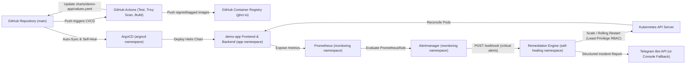

# Self-Healing Cloud Platform

An end-to-end DevOps / SRE portfolio project demonstrating **GitOps continuous delivery**, **Prometheus-driven observability**, and **automated Kubernetes incident remediation** with strict **Least-Privilege RBAC** and **Telegram incident reporting**.

When an application pod experiences a simulated memory spike (`app_simulated_memory_mb > 400`), elevated HTTP 5xx error rates (`> 5%`), or container crash loops, Prometheus and Alertmanager automatically route the critical alert to a custom FastAPI **Remediation Engine** that scales or restarts the affected Deployment via the Kubernetes API and dispatches a structured incident report—reducing Mean Time To Recovery (MTTR) without human intervention.

---

## Architecture



---

## Tech Stack & Components

| Layer | Technology | Location |
| :--- | :--- | :--- |
| **Application** | FastAPI (`prometheus-fastapi-instrumentator`), Nginx (unprivileged), Docker multi-stage | [`app/backend/`](app/backend/), [`app/frontend/`](app/frontend/) |
| **Local Development** | Docker Compose | [`docker-compose.yml`](docker-compose.yml) |
| **Infrastructure as Code** | Terraform (`kind`, `kubernetes`, `helm` providers) | [`terraform/`](terraform/) |
| **Kubernetes Packaging** | Parameterized Helm v3 chart (Deployments, Services, Ingress, HPA) | [`charts/demo-app/`](charts/demo-app/) |
| **GitOps Delivery** | ArgoCD `AppProject` & `Application` (`prune: true`, `selfHeal: true`) | [`gitops/`](gitops/) |
| **Observability & Alerting** | `kube-prometheus-stack`, `PrometheusRule`, `AlertmanagerConfig` | [`monitoring-config/`](monitoring-config/) |
| **Auto-Remediation** | Python FastAPI + official `kubernetes` client + Telegram Bot API | [`remediation-engine/`](remediation-engine/) |
| **CI/CD Pipeline** | GitHub Actions (`pytest`, `helm lint`, Trivy scan, GHCR push, GitOps bump) | [`.github/workflows/ci-cd.yml`](.github/workflows/ci-cd.yml) |
| **Verification** | End-to-end chaos & auto-scaling test script | [`scripts/simulate-incident.sh`](scripts/simulate-incident.sh) |

---

## Quickstart Guide

### Prerequisites

- Docker & Docker Compose
- `terraform` (`>= 1.5.0`), `kind`, `kubectl`, `helm`, `make`

### 1. Run Locally with Docker Compose (Optional)

Verify the FastAPI backend and Nginx dashboard locally before provisioning Kubernetes:

```bash
docker compose up --build
```

- Dashboard UI: `http://localhost:8080`
- Backend API / Metrics: `http://localhost:8000/api/items` and `http://localhost:8000/metrics`

### 2. Provision the Multi-Node Kubernetes Cluster

Bootstrap the 3-node Kind cluster (`self-healing-cluster`: 1 control-plane, 2 workers), namespaces (`app`, `monitoring`, `argocd`, `self-healing`), `kube-prometheus-stack`, and `argo-cd` using Terraform:

```bash
make infra-up
```

Inspect cluster nodes, pods, and Helm releases:

```bash
make status
```

### 3. Deploy the Remediation Engine & Alerting Rules

Configure optional Telegram credentials in [`remediation-engine/k8s/secret.yaml`](remediation-engine/k8s/secret.yaml) (if left blank, reports fall back cleanly to structured console logs), build/load the local images into Kind if running offline, and apply the manifests:

```bash
# Load locally built images into Kind (if not pulling from GHCR)
kind load docker-image self-healing-backend:0.1.0 --name self-healing-cluster
kind load docker-image self-healing-frontend:0.1.0 --name self-healing-cluster
kind load docker-image remediation-engine:0.1.0 --name self-healing-cluster

# Deploy Remediation Engine (ServiceAccount, Least-Privilege RBAC, Deployment, Service)
kubectl apply -f remediation-engine/k8s/ --context kind-self-healing-cluster

# Apply PrometheusRule & AlertmanagerConfig
kubectl apply -f monitoring-config/ --context kind-self-healing-cluster
```

### 4. Bootstrap GitOps with ArgoCD

Update `spec.source.repoURL` in [`gitops/demo-app-application.yaml`](gitops/demo-app-application.yaml) to point to your repository, then bootstrap ArgoCD:

```bash
make gitops-apply
```

### 5. Simulate an Incident & Verify Auto-Healing

Run the end-to-end verification script to port-forward the backend, trigger `/chaos/memory` above the `400 MB` threshold, tail `remediation-engine` logs, and confirm Kubernetes scales up `demo-app-backend` automatically:

```bash
./scripts/simulate-incident.sh
```

### 6. Tear Down Infrastructure

```bash
make infra-down
```

---

## Key Engineering Decisions

### 1. Strict Least-Privilege RBAC & Pod Hardening
- The Remediation Engine runs inside the `self-healing` namespace under a dedicated `ServiceAccount` (`remediation-sa`), isolated from the `app` workload namespace.
- Rather than using a cluster-wide `ClusterRole`, [`remediation-engine/k8s/rbac.yaml`](remediation-engine/k8s/rbac.yaml) defines a namespaced `Role` scoped **exclusively to the `app` namespace**, granting only `get`, `list`, `watch`, `patch`, and `update` on `deployments` and `pods` (bound cross-namespace via a `RoleBinding` in `app`).
- All custom containers (`app/backend`, `app/frontend`, `remediation-engine`) use multi-stage slim/alpine Docker builds running as non-root `appuser`, and the Kubernetes `Deployment` enforces `runAsNonRoot: true`, `readOnlyRootFilesystem: true`, `allowPrivilegeEscalation: false`, `capabilities.drop: ["ALL"]`, and `RuntimeDefault` seccomp.

### 2. GitOps Drift Prevention & Automated Rollouts
- [`gitops/demo-app-application.yaml`](gitops/demo-app-application.yaml) configures ArgoCD with `automated` sync (`prune: true`, `selfHeal: true`) and exponential backoff retries (`limit: 5`), ensuring manual `kubectl` edits or configuration drift in the cluster are automatically reverted to the declarative Git state.
- The CI/CD workflow ([`.github/workflows/ci-cd.yml`](.github/workflows/ci-cd.yml)) gates image pushes behind unit tests (`pytest`), chart validation (`helm lint`), and Trivy vulnerability scanning (`CRITICAL`/`HIGH`), then commits updated image tags back to [`charts/demo-app/values.yaml`](charts/demo-app/values.yaml) (`[skip ci]`) so ArgoCD performs zero-downtime rolling updates.

### 3. Automated MTTR (Mean Time To Recovery) Reduction
- **Metrics to Action in Seconds**: `app/backend` exports real-time HTTP metrics and `app_simulated_memory_mb` via `prometheus-fastapi-instrumentator`. [`monitoring-config/prometheus-rule.yaml`](monitoring-config/prometheus-rule.yaml) evaluates `HighSimulatedMemory`, `HighErrorRate`, and `PodCrashLooping` over `30s` windows, and [`monitoring-config/alertmanager-config.yaml`](monitoring-config/alertmanager-config.yaml) routes `critical` alerts from `app` directly to `remediation-engine`.
- **Guardrailed Remediation**: Scaling actions enforce a hard ceiling (`MAX_REPLICAS=5`) to prevent runaway resource exhaustion during cascading failures, while crash-looping workloads trigger targeted rolling restarts and emit structured incident summaries to Telegram (with automatic console logging fallback).
